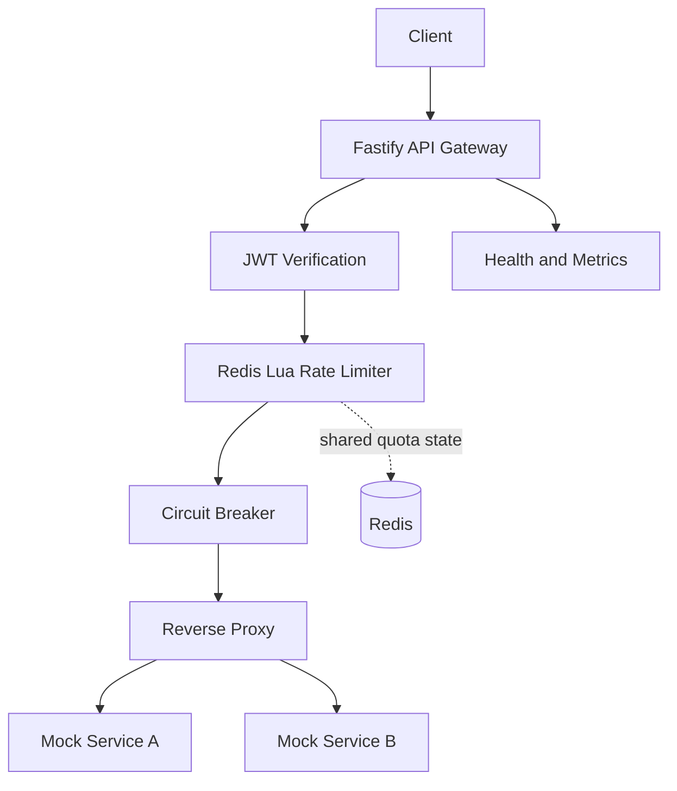

# API Gateway with Distributed Rate Limiting & Circuit Breakers
## Solo-Developer SDLC and Implementation Blueprint

**Project type:** Individual portfolio project  
**Primary goal:** Demonstrate backend engineering, distributed systems fundamentals, security at the edge, fault tolerance, and performance testing.  
**Target timeline:** 4 weeks of focused work, with an optional polish week.  
**Recommended stack:** Node.js, TypeScript, Fastify, Redis, Lua, Vitest, Supertest, k6, Docker Compose.

---

## 1. Executive Summary

Build a lightweight API gateway that serves as the single entry point for client requests and forwards them to two small downstream services. The gateway will enforce JWT authentication, apply a Redis-backed distributed rate limiter, protect services with circuit breakers and timeouts, add request-tracing headers, and expose health and metrics endpoints.

This is an **individual engineering project**, not an enterprise gateway product. Prioritize a small number of correctly implemented, well-tested features and reproducible measurements over a broad feature list.

### The final demo should prove that

1. Valid requests are routed to the correct downstream service.
2. Invalid or missing JWTs are rejected.
3. Rate limits are enforced correctly under concurrent requests and across two gateway instances.
4. A failing downstream service causes its circuit breaker to open and fail fast.
5. The breaker can recover after a successful half-open probe.
6. Load and fault-injection tests report honest, repeatable results.

## 2. Scope and Non-Goals

### MVP features

- Reverse-proxy routing for two services.
- Request ID generation and propagation.
- JWT verification using a documented signing algorithm and test keys.
- Redis-backed token-bucket rate limiting using an atomic Lua script.
- Per-route or per-service circuit breaker with `CLOSED`, `OPEN`, and `HALF_OPEN` states.
- Connection and request timeouts.
- Safe error responses and bounded retry behavior only where retrying is safe.
- Health/readiness endpoints.
- Structured logs and basic metrics.
- Docker Compose environment.
- Unit, integration, concurrency, fault-injection, and load tests.
- Architecture diagram, setup guide, benchmark report, and short demo recording.

### Explicitly out of scope for the first release

- Kubernetes, service mesh, multi-region deployment, and autoscaling.
- A custom management UI.
- Dynamic service discovery or a configuration control plane.
- Multiple authentication providers or full OAuth authorization-server implementation.
- Distributed circuit-breaker coordination unless it becomes the core research objective.
- Production secrets management, multi-tenant administration, and enterprise compliance claims.

**Scope rule:** If a feature does not strengthen routing correctness, rate-limit correctness, security, resilience, or measurable evaluation, defer it.

## 3. Requirements

### Functional requirements

| ID | Requirement | Acceptance criterion |
|---|---|---|
| FR-01 | Route requests to configured upstreams | Integration tests prove correct service, path, method, and query forwarding |
| FR-02 | Validate JWTs | Missing, malformed, expired, or incorrectly signed tokens return `401` |
| FR-03 | Add request IDs | Every request receives a unique ID; the ID is propagated downstream |
| FR-04 | Enforce rate limits | Requests within quota pass; excess requests return `429` |
| FR-05 | Enforce limits across gateway replicas | Two gateway instances share the same Redis-backed quota |
| FR-06 | Open circuit on sustained failure | Configured failure threshold opens the breaker |
| FR-07 | Fail fast while circuit is open | Requests do not call the unhealthy upstream and return `503` |
| FR-08 | Probe recovery | After cooldown, only a controlled probe is admitted; success closes the breaker |
| FR-09 | Bound waiting time | Upstream requests time out within configured limits |
| FR-10 | Report service health | Liveness and readiness accurately reflect process and dependency status |
| FR-11 | Expose useful telemetry | Counters include requests, rejections, upstream failures, timeouts, and breaker transitions |
| FR-12 | Run reproducibly | One documented command starts the local stack |

### Non-functional requirements

- **Correctness:** deterministic behavior for boundary conditions and concurrent requests.
- **Security:** never trust client-supplied identity headers; do not log tokens or secrets.
- **Reliability:** timeouts and bounded resource use for every upstream call.
- **Maintainability:** typed configuration, small modules, clear interfaces, and automated tests.
- **Reproducibility:** pinned dependencies, deterministic test keys, documented environment, and repeatable benchmark commands.
- **Honest evaluation:** report machine details, test parameters, raw outputs, and limitations.

## 4. Architecture



### Request lifecycle

1. Accept request and assign a request ID.
2. Validate route and request size limits.
3. Verify JWT when the route requires authentication.
4. Derive a rate-limit identity from verified claims, or a carefully normalized IP for public routes.
5. Execute the rate-limit Lua script in Redis.
6. Reject excess requests with `429` and useful rate-limit headers.
7. Check the relevant circuit breaker.
8. Forward to the upstream with a deadline and trusted tracing/identity headers.
9. Normalize upstream failures into safe gateway responses.
10. Record metrics and structured logs without sensitive data.

### Recommended request path

Use **Fastify + a maintained proxy plugin** for routing instead of writing a general-purpose HTTP proxy from scratch. Keep the rate limiter and circuit breaker as independently testable modules. A custom proxy implementation is not necessary to demonstrate distributed-systems knowledge and can introduce avoidable networking bugs.

## 5. Technology Decisions

| Concern | Recommendation | Reason |
|---|---|---|
| Runtime | Node.js LTS + TypeScript | Strong backend ecosystem and typed implementation |
| HTTP server | Fastify | Small, performant, schema-friendly server |
| Proxying | Maintained Fastify proxy plugin or well-tested proxy library | Avoid reinventing low-level HTTP forwarding |
| Shared state | Redis | Atomic shared state across gateway replicas |
| Rate limit algorithm | Token bucket | Clear burst and refill semantics; implement with Lua |
| JWT | Established JWT library | Avoid writing cryptography yourself |
| Tests | Vitest + Supertest or Fastify inject | Fast unit and integration feedback |
| Load testing | k6 | Repeatable load profiles and latency percentiles |
| Local infrastructure | Docker Compose | Reproducible local demo |
| Metrics | Prometheus-compatible endpoint or lightweight counters | Quantify behavior without building a dashboard |

Pin dependency versions and use a lockfile. Use one package manager consistently.

## 6. Repository Structure

```text
api-gateway/
├── src/
│   ├── app.ts
│   ├── server.ts
│   ├── config/
│   │   └── env.ts
│   ├── middleware/
│   │   ├── request-id.ts
│   │   └── authenticate.ts
│   ├── rate-limit/
│   │   ├── token-bucket.ts
│   │   ├── token-bucket.lua
│   │   └── keys.ts
│   ├── circuit-breaker/
│   │   ├── breaker.ts
│   │   └── state.ts
│   ├── proxy/
│   │   ├── routes.ts
│   │   └── upstream-errors.ts
│   ├── observability/
│   │   ├── logger.ts
│   │   └── metrics.ts
│   └── routes/
│       ├── health.ts
│       └── metrics.ts
├── services/
│   ├── service-a/
│   └── service-b/
├── tests/
│   ├── unit/
│   ├── integration/
│   ├── concurrency/
│   └── fault-injection/
├── load/
│   ├── baseline.js
│   ├── rate-limit.js
│   └── downstream-failure.js
├── scripts/
├── docker-compose.yml
├── .env.example
├── .gitignore
├── package.json
├── tsconfig.json
└── README.md
```

Keep this structure flexible. Create files when needed rather than generating empty modules for every directory at the beginning.

## 7. Core Design Details

### 7.1 Distributed token bucket

Use a Redis Lua script so reading the bucket state, refilling tokens, deciding whether a request is allowed, and writing the updated state occur atomically.

For a bucket with capacity `B`, refill rate `r` tokens per second, previous token balance `T`, and elapsed time `dt`:

```text
refilled = min(B, T + max(0, dt) * r)

if refilled >= request_cost:
    allowed = true
    new_tokens = refilled - request_cost
else:
    allowed = false
    new_tokens = refilled
```

Persist token count and last-refill timestamp. Set a TTL long enough to cover idle refill behavior. Define the time source and precision carefully; Redis server time can avoid relying on clocks from multiple gateway machines.

**Required tests**
- First request and full-bucket behavior.
- Exact quota boundary.
- Refill over time.
- Rejection when insufficient tokens remain.
- Bucket expiry and recreation.
- Concurrent requests against the same key.
- Same user quota across two gateway instances.
- Redis error behavior.

Choose and document the failure policy when Redis is unavailable. For a security-sensitive protected route, failing closed may preserve quota enforcement but reduce availability; failing open improves availability but bypasses rate limiting. Make the trade-off explicit and test it.

### 7.2 Circuit breaker

Implement a small state machine around upstream calls.

- **CLOSED:** Requests are forwarded; qualifying failures are counted over a defined rolling window.
- **OPEN:** Requests fail fast with `503 Service Unavailable` until the cooldown expires.
- **HALF_OPEN:** Permit one probe request (or a very small configured number). A success closes the breaker; a qualifying failure reopens it.

Configuration should include:
- failure threshold and measurement window;
- cooldown duration;
- upstream timeout;
- definition of a qualifying failure;
- half-open probe limit.

Do not count ordinary client errors such as `400` or `404` as upstream availability failures. Usually count connection errors, timeouts, and selected `5xx` responses. Always release probe permissions even when requests throw exceptions.

**Solo-MVP choice:** Start with an in-memory breaker per gateway process. State clearly that the breaker is local to each replica. Distributed rate limiting is the primary shared-state feature. Add coordinated distributed breaker state only if it is central to the project claim; distributed half-open probes require careful atomic coordination.

### 7.3 JWT and header trust

- Use a maintained JWT library and explicitly allow only expected algorithms.
- Validate signature, expiry, issuer, and audience as appropriate.
- Never accept identity or role headers directly from the client.
- Remove client-supplied internal identity headers before forwarding.
- Inject a trusted user identifier only after verification.
- Prefer a dedicated header such as `X-Authenticated-User` over serializing all claims into `X-User-Data`.
- Do not log authorization headers, tokens, secrets, or full sensitive claims.
- Use test-only keys in development and document key rotation as a production concern.

### 7.4 Proxy and error handling

- Use explicit route-to-upstream configuration; never construct an upstream URL from an untrusted `Host` or arbitrary client URL.
- Enforce request body size limits and upstream timeouts.
- Preserve intended HTTP methods, query strings, and safe headers.
- Strip hop-by-hop headers and untrusted internal headers.
- Return consistent error payloads and do not leak stack traces or internal hostnames.
- Be conservative with retries. Do not automatically retry non-idempotent requests unless an idempotency strategy is implemented.

### 7.5 HTTP status conventions

| Situation | Status |
|---|---:|
| Missing/invalid authentication | `401 Unauthorized` |
| Authenticated but forbidden | `403 Forbidden` |
| Rate limit exceeded | `429 Too Many Requests` |
| Open circuit / upstream unavailable | `503 Service Unavailable` |
| Gateway's upstream timeout | `504 Gateway Timeout` |
| Unexpected internal gateway error | `500 Internal Server Error` |

Use `Retry-After` when it is meaningful and known. Do not use nonstandard `530` as the default circuit-open response.

## 8. API Contract

Keep the public API intentionally small. Example routes:

| Route | Purpose |
|---|---|
| `GET /health/live` | Process liveness |
| `GET /health/ready` | Readiness, including required dependency checks |
| `GET /metrics` | Prometheus-compatible metrics, if enabled |
| `/api/v1/service-a/*` | Proxy to Service A |
| `/api/v1/service-b/*` | Proxy to Service B |

Possible error format:

```json
{
  "error": {
    "code": "RATE_LIMIT_EXCEEDED",
    "message": "Too many requests",
    "requestId": "generated-request-id"
  }
}
```

Do not expose internal exceptions, upstream credentials, Redis keys, or tokens in responses.

## 9. SDLC: Four-Week Solo Execution Plan

### Phase 0 — Define the smallest useful product (half day)

**Tasks**
- Create a repository and short README.
- Write the functional requirements and acceptance criteria from this document.
- Select the two mock services and define their routes.
- Record initial assumptions and known non-goals.
- Create a task board with small, testable issues.

**Deliverables**
- Scope document.
- Route table.
- Initial architecture diagram.
- Definition of done.

**Exit gate:** Every MVP feature has an observable acceptance test; no enterprise-only work is in scope.

### Phase 1 — Project foundation and proxy (Days 1–4)

**Tasks**
1. Initialize TypeScript, Fastify, linting, formatting, and test tooling.
2. Implement `/health/live`.
3. Create two mock upstream services with deterministic test endpoints.
4. Add explicit proxy routes and request ID propagation.
5. Normalize timeout and upstream connection errors.
6. Add Docker Compose for local services.

**Tests**
- Correct path, method, query, and body forwarding.
- Unknown route handling.
- Upstream unavailable and timeout cases.
- Request ID generation and propagation.

**Exit gate:** A request passes through the gateway to both services and tests run locally with one documented command.

### Phase 2 — Authentication and safe request handling (Days 5–7)

**Tasks**
1. Add JWT verification with test keys.
2. Validate signature and expiry; validate issuer/audience if configured.
3. Remove untrusted identity headers.
4. Add request-size limits and safe error formatting.
5. Add structured logs with redaction.

**Tests**
- Missing, malformed, expired, wrong-signature token.
- Correct token.
- Spoofed identity headers.
- No token or secret appears in logs.

**Exit gate:** Protected routes reject invalid credentials and only trusted verified claims influence downstream identity.

### Phase 3 — Redis distributed rate limiting (Days 8–12)

**Tasks**
1. Add Redis connection lifecycle and configuration.
2. Define token bucket semantics and key derivation.
3. Implement Lua refill/check/update script.
4. Return `429` and relevant rate-limit headers.
5. Add an explicit Redis-unavailable policy.
6. Start two gateway replicas and validate shared quotas.

**Tests**
- Unit tests for key generation and result interpretation.
- Integration tests for bucket refill and boundaries.
- Concurrency test with many simultaneous requests.
- Two-replica shared quota test.
- Redis outage test.

**Exit gate:** Quotas remain consistent across gateway instances, and concurrency tests match the documented algorithm.

### Phase 4 — Circuit breaker and resilience (Days 13–16)

**Tasks**
1. Implement breaker states and configuration.
2. Count only qualifying upstream failures.
3. Add request deadlines and upstream timeouts.
4. Add a single half-open probe per process.
5. Add controlled failure and latency modes to one mock service.
6. Return safe `503` and `504` errors as appropriate.

**Tests**
- State transition tests with a fake clock where practical.
- Breaker opens at the configured threshold.
- Open state avoids upstream calls.
- Half-open success closes the breaker.
- Half-open failure reopens it.
- Probe lock is released after exceptions.
- Client errors do not incorrectly trip the breaker.

**Exit gate:** Fault-injection tests prove fail-fast behavior and recovery.

### Phase 5 — Observability, benchmark, and release (Days 17–20)

**Tasks**
1. Add counters for requests, status codes, rate-limit rejections, upstream errors, timeouts, and breaker transitions.
2. Add baseline and rate-limit k6 scenarios.
3. Add downstream failure and recovery scenario.
4. Capture environment details and raw benchmark output.
5. Run full test suite and security-focused checks.
6. Document limitations and known trade-offs.
7. Record a short demo.

**Deliverables**
- Passing test suite.
- Benchmark report with reproducible commands.
- Architecture and request-flow diagrams.
- README with setup, configuration, and limitations.
- Demo video or GIF.

**Exit gate:** A new developer can start the project, run tests, reproduce the demo, and understand the reported measurements.

### Optional Week 5 — Polish only

Use an additional week only for fixes that improve correctness, reproducibility, usability, or evidence. Possible additions: Prometheus dashboard, a small comparison against an in-memory limiter, or deployment to one inexpensive host. Do not add these until all core acceptance criteria pass.

## 10. Test-Driven Development Workflow

For each feature, follow **Red → Green → Refactor**:

1. **Red:** Write a focused failing test describing observable behavior.
2. **Green:** Implement the smallest change that makes the test pass.
3. **Refactor:** Simplify implementation while keeping tests green.
4. Run the relevant tests, then the full suite before committing.
5. Add a regression test for every bug found.

### Test layers

- **Unit:** token bucket math, key generation, breaker transitions, config validation, error mapping.
- **Integration:** Fastify routes, Redis script, JWT middleware, proxy behavior.
- **Concurrency:** same-key simultaneous requests and two gateway replicas.
- **Fault injection:** Redis unavailable, slow upstream, crashed upstream, recovery.
- **Load:** baseline traffic, rate-limit saturation, and downstream failure.

Avoid tests that depend on arbitrary sleeps when a fake clock or explicit synchronization can make the test deterministic.

## 11. Benchmarking and Evaluation

The benchmark is what elevates the project beyond a tutorial implementation.

### Record these metrics

| Metric | What it demonstrates |
|---|---|
| Throughput (requests/second) | Processing capacity under a stated workload |
| p50, p95, p99 latency | Typical and tail response times |
| Rate-limit accuracy | Whether concurrent requests respect the quota |
| Rejection rate | Whether over-quota traffic is rejected as expected |
| Open-circuit latency | Whether failures are returned quickly |
| Recovery time | Time from upstream recovery to successful gateway responses |
| Error rate | Gateway and upstream failures under each scenario |
| CPU and memory | Resource cost under a repeatable workload |

### Minimum experiment matrix

| Experiment | Baseline | Stress/failure condition |
|---|---|---|
| Proxy performance | One gateway, healthy upstream | Higher virtual-user count |
| Distributed quota | One gateway | Two gateway replicas sharing Redis |
| Concurrency correctness | Low concurrency | Burst of concurrent same-identity requests |
| Circuit breaker | Healthy upstream | Upstream returns errors / times out |
| Recovery | Breaker open | Upstream restored after cooldown |
| Redis dependency | Redis healthy | Redis stopped or made unreachable |

Record:
- hardware and OS;
- Node.js, Redis, Docker, and k6 versions;
- virtual users, duration, ramp-up, and request mix;
- gateway replica count;
- configured quotas and breaker thresholds;
- raw outputs and the exact command used.

Do not state that the gateway is “high-throughput,” “zero-race,” or “production-ready” without defining and measuring the claim. Publish actual results, including poor results and limitations.

## 12. Security and Reliability Checklist

- [ ] JWT verification uses a maintained library and a fixed algorithm allowlist.
- [ ] Expiry and relevant issuer/audience claims are checked.
- [ ] Client-provided internal identity headers are removed.
- [ ] Secrets and authorization tokens are redacted from logs.
- [ ] Upstream destinations come only from trusted configuration.
- [ ] Request bodies and header sizes have reasonable limits.
- [ ] Every upstream call has a timeout.
- [ ] Retries are bounded and only used where safe.
- [ ] Redis outage behavior is documented and tested.
- [ ] Rate-limit keys cannot be manipulated to create unbounded key cardinality.
- [ ] Error responses avoid leaking internals.
- [ ] Health endpoints do not disclose secrets or detailed infrastructure information.
- [ ] Dependencies are locked and scanned with available tooling.
- [ ] Shutdown closes the HTTP server and Redis client cleanly.

## 13. Definition of Done

The project is complete when:

- [ ] Both configured upstreams work through the gateway.
- [ ] JWT tests cover invalid and valid tokens.
- [ ] Rate limiting uses an atomic Redis operation.
- [ ] A shared quota is demonstrated across two gateway instances.
- [ ] Circuit-breaker transitions and recovery are tested.
- [ ] Timeouts and upstream errors map to documented responses.
- [ ] Unit and integration tests run from documented commands.
- [ ] k6 scripts and benchmark results are checked into the repository.
- [ ] Docker Compose starts the local demo reproducibly.
- [ ] README includes architecture, setup, API examples, trade-offs, and limitations.
- [ ] Demo shows normal traffic, rate-limit rejection, circuit opening, and recovery.
- [ ] Resume metrics are based on measured evidence only.

## 14. Demo Script (3–5 Minutes)

1. Start the stack and show health checks.
2. Send a valid authenticated request through the gateway.
3. Send an invalid JWT and show `401`.
4. Exceed the quota and show `429` plus rate-limit headers.
5. Repeat requests through two gateway replicas to demonstrate shared quota state.
6. Enable failure mode in Service B and send requests until the breaker opens.
7. Show fast `503` responses while open and confirm the upstream is not called.
8. Restore Service B, wait for the half-open probe, and show the breaker closing.
9. Run a short k6 test and show measured throughput and latency.
10. Close with the architecture and limitations.

## 15. Resume Positioning

Only use the bullets after the corresponding features are implemented and verified. Replace bracketed values with measured results.

- Built a TypeScript API gateway with authenticated reverse-proxy routing, request tracing, and explicit upstream timeout/error handling.
- Implemented a Redis-backed distributed token-bucket rate limiter using atomic Lua scripts; validated quota behavior across **[N]** gateway instances and **[concurrency level]** concurrent requests.
- Implemented a circuit breaker with closed/open/half-open states and fault-injection tests; measured **[p95 latency]**, **[throughput]**, and **[recovery time]** under a documented workload.

Do not claim “zero race conditions,” “production-grade,” or specific throughput improvements without reproducible evidence.

## 16. Main Risks and Mitigations

| Risk | Mitigation |
|---|---|
| Scope expands into a full gateway product | Freeze MVP and defer dashboard, dynamic discovery, Kubernetes, and multi-region work |
| Writing a custom proxy consumes time | Use a maintained proxy library and focus on gateway policies |
| Rate limiter has concurrency bugs | Use atomic Lua and dedicated concurrency tests |
| Circuit breaker is flaky in tests | Use deterministic clocks and explicit probe synchronization |
| Redis outage behavior is unclear | Choose fail-open/fail-closed per route and test the policy |
| Benchmark results are misleading | Document workload, environment, raw results, and limitations |
| Resume claims overstate results | Tie every quantitative claim to a checked-in benchmark |

## 17. Final Engineering Principles

1. Build the smallest complete vertical slice first.
2. Use TDD for the rate limiter and breaker state machine.
3. Prefer standard libraries for cryptography and proxy mechanics.
4. Keep the token-bucket implementation atomic and its semantics documented.
5. Be explicit about what is shared across replicas and what is process-local.
6. Test failure paths as deliberately as success paths.
7. Measure before optimizing.
8. Keep the project runnable with a single documented setup path.
9. Treat the README, benchmark report, and demo as part of the engineering deliverable.
10. Finish the MVP before adding optional infrastructure.

---

**Success criterion:** One developer can build, test, explain, and demonstrate the gateway in approximately four weeks, with credible evidence of correctness and resilience rather than an oversized feature list.
