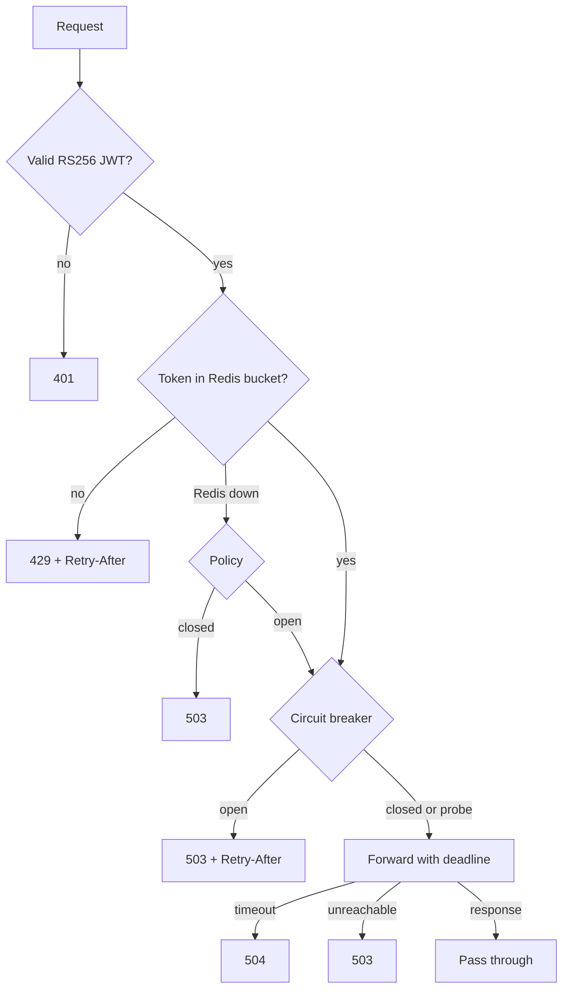

# API Gateway with Distributed Rate Limiting & Circuit Breakers

A small TypeScript gateway (Fastify) in front of two services: RS256 JWT authentication, a
Redis token bucket (one atomic Lua script) so several replicas enforce a **single shared
quota**, per-service circuit breakers with timeouts, request IDs, redacted logs, health
checks and Prometheus metrics. An individual project, not a production gateway: [limitations](#limitations).

## Architecture

Redis is the only state replicas share; each replica keeps its own breakers.
## Quick start

Needs Node 22+ and Docker; the tests need a real Redis (the limiter is a Lua script).
    npm install
    docker compose up -d redis
    npm run check                      # typecheck + lint + tests

Full stack (Redis, two mock services, two gateway replicas on 127.0.0.1:3001 and :3002):
    node scripts/dev-keys.mjs          # test-only RS256 keys into .dev/ (gitignored)
    docker compose up -d --build
    TOKEN=$(node scripts/mint-token.mjs alice)
    curl -i -H "Authorization: Bearer $TOKEN" 127.0.0.1:3001/api/v1/service-a/ping

Compose quota defaults to 10, refilling 1/s. Without Docker: `npm run build && npm start`.

## API

| Route | Auth | Purpose |
|---|---|---|
| `/api/v1/service-a/*`, `/service-b/*` | JWT | Proxied; prefix stripped; method, query, body unchanged |
| `GET /health/live`, `/health/ready` | none | Process up / Redis reachable (`200` or `503`) |
| `GET /metrics` | optional | Prometheus counters (no histograms); bearer `METRICS_TOKEN` if set |

Upstreams get `X-Request-Id` and `X-Authenticated-User` (the verified `sub`). Client
`Authorization`, `Cookie`, `X-Request-Id`, `X-Authenticated-*` and `X-Internal-*` headers are
dropped, so the token is never forwarded and identity cannot be spoofed. Proxied responses
carry `RateLimit-Limit`, `-Remaining` and `-Reset`. Errors share one shape and never expose
stacks, upstream addresses or Redis details:
`{"error":{"code":"RATE_LIMIT_EXCEEDED","message":"Too many requests","requestId":"..."}}`

| Status | `code` | When |
|---:|---|---|
| 401 | `UNAUTHENTICATED` | Missing, malformed, expired, wrong key/issuer/audience, non-RS256 |
| 404 / 413 | `NOT_FOUND` / `PAYLOAD_TOO_LARGE` | Unknown route / body over the limit |
| 429 | `RATE_LIMIT_EXCEEDED` | Bucket empty |
| 503 | `RATE_LIMITER_UNAVAILABLE` | Redis down and policy is `closed` |
| 503 | `CIRCUIT_OPEN` / `UPSTREAM_UNAVAILABLE` | Breaker open (upstream not called) / connection failed |
| 504 | `UPSTREAM_TIMEOUT` | Upstream exceeded the deadline |

## Configuration

Environment variables, validated at startup (`.env.example` lists them all).
| Variable | Default | Meaning |
|---|---|---|
| `SERVICE_A_URL`, `SERVICE_B_URL` | required | Upstream base URLs; never derived from a request |
| `JWT_PUBLIC_KEY_PEM`, `JWT_ISSUER`, `JWT_AUDIENCE` | required | RS256 SPKI public key; expected `iss`, `aud` |
| `REDIS_URL` | `redis://127.0.0.1:6379` | Rate-limit state |
| `RATE_LIMIT_CAPACITY`, `_REFILL_PER_SEC` | `100`, `10` | Burst size, sustained rate |
| `RATE_LIMIT_FAIL_POLICY` | `closed` | `closed`: 503 if Redis is down. `open`: serve unthrottled |
| `UPSTREAM_TIMEOUT_MS` | `3000` | Connect, headers and body timeout |
| `BREAKER_FAILURE_THRESHOLD`, `_WINDOW_MS`, `_COOLDOWN_MS`, `_HALF_OPEN_PROBES` | `5`, `10000`, `5000`, `1` | Breaker tuning |
| `METRICS_TOKEN` | unset | If 16+ chars, `/metrics` requires it as a bearer token |

## Design decisions

- **Token bucket in Lua.** Refill, decision and write are one Redis call, so concurrent
  requests from any replica cannot interleave. Time comes from Redis `TIME`, not replica
  clocks. Keys are `rl:v1:<service>:<sha256(sub)>` (fixed size, per user and per service).
- **Redis outage.** Commands fail fast (no offline queue, 200 ms timeout). `closed` never
  bypasses quotas but makes Redis a hard dependency; `open` stays available and counts each
  bypass. Readiness reports `503` either way; liveness stays `200`.
- **Breaker.** Opens after N qualifying failures in a rolling window, then admits limited probes
  after the cooldown. Connection errors, timeouts and upstream 500/502/503/504 count; 4xx
  never do. Abandoned requests release their probe permit; stale results are ignored.
- **Auth before limiting.** Only RS256 is accepted (blocks `alg=none`, HS256 confusion), so quota
  keys come from verified identities; invalid-token floods get `401` but are not throttled.
- **Logs** omit query strings and redact credentials; a test found `@fastify/reply-from`
  logging `?access_token=...`, now redacted.

## Testing and CI

`npm run check` (typecheck, lint, tests; needs Redis), `npm run smoke` (boots the compiled
`dist/` build end to end, after `npm run build`) and `npm run audit` (moderate+ for runtime
dependencies, high+ for all). Tests include 500 simultaneous requests on one key, two gateways
sharing one quota, JWT attacks, header spoofing, log redaction, breaker recovery and both
outage policies. `.github/workflows/ci.yml` runs tests (Node 22 and 24 with a Redis service),
build + smoke, audit and a Docker build. **It has not yet run on GitHub**; its commands were
verified locally from a clean `npm ci`. It must sit at the repository root, and actions are
pinned to major versions, not SHAs.

## Benchmarks

`bash scripts/bench.sh` runs k6 in Docker ([`benchmarks/README.md`](benchmarks/README.md)).
Each figure is **one run on one laptop**, with k6, Redis, mocks and gateways sharing it:

- **Rate-limit accuracy** (capacity 100, 10/s, 100 req/s for 20 s; max possible 300): one
  gateway admitted 299, two gateways admitted 300.
- **Service down for 15 s at 20 req/s:** breaker open in 249 ms, fast-503 p99 4.1 ms, first
  success 395 ms after restore (one sample, bounded by the cooldown).
- **Baseline, 100 VUs:** 1,670 req/s with one gateway, 1,923 with two. This is not evidence of
  scaling. A run corrupted by a host stall is kept and labelled invalid.

## Limitations

- Breaker state is per replica; one Redis node only (failover and Cluster untested). No
  IP-based or per-route limits, roles/`403`, key rotation, TLS termination or retries.
- `/health/*` (and `/metrics` without a token) are unauthenticated: keep them internal.
- Benchmarks use mock upstreams, one run each, no CPU/memory; no image scanning.
