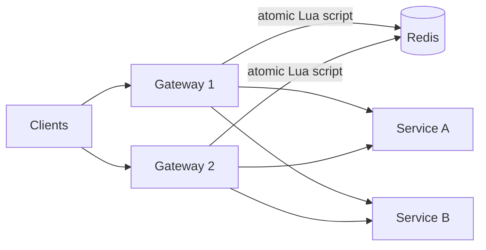
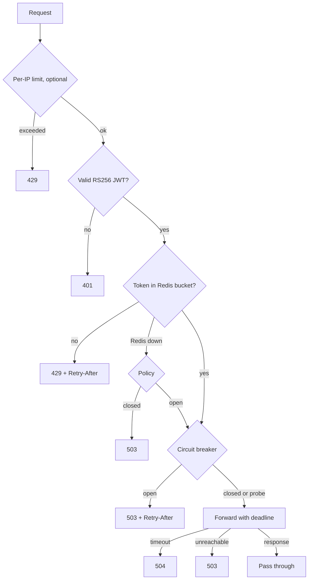

# API Gateway with Distributed Rate Limiting & Circuit Breakers

A small TypeScript gateway (Fastify) in front of two services: RS256 JWT auth, a Redis token bucket
(one atomic Lua script) giving replicas a **single shared quota**, per-service circuit breakers,
redacted logs, health checks and metrics. An individual project, not production-ready: [limitations](#limitations).

## Architecture

Redis is the only state replicas share; each keeps its own breakers. Request steps, in order:

## Quick start

Needs Node 22+ and Docker; the tests need a real Redis (the limiter is a Lua script).

    npm install
    docker compose up -d redis
    npm run check                      # typecheck + lint + tests

Full stack (Redis, two mock services, two gateway replicas on 127.0.0.1:3001 and :3002):

    node scripts/dev-keys.mjs          # test-only RS256 keys into .dev/ (gitignored)
    docker compose up -d --build
    TOKEN=$(node scripts/mint-token.mjs alice)
    curl -i -H "Authorization: Bearer $TOKEN" 127.0.0.1:3001/api/v1/service-a/ping

More commands (demo recording, benchmarks, troubleshooting): [RUN.md](RUN.md).

## API

| Route | Auth | Purpose |
|---|---|---|
| `/api/v1/service-a/*`, `/service-b/*` | JWT | Proxied; prefix stripped; method, query, body unchanged |
| `GET /health/live`, `/health/ready` | none | Process up / Redis reachable (`200` or `503`) |
| `GET /metrics` | optional | Prometheus counters (no histograms); bearer `METRICS_TOKEN` (16+ chars) if set |

Upstreams get `X-Request-Id` and `X-Authenticated-User` (the verified `sub`); client
`Authorization`, `Cookie`, `X-Request-Id`, `X-Authenticated-*` and `X-Internal-*` are dropped, so the
token is never forwarded and identity cannot be spoofed. Responses carry `RateLimit-*` headers.
Errors share one shape and expose no internals:
`{"error":{"code":"RATE_LIMIT_EXCEEDED","message":"Too many requests","requestId":"..."}}`

| Status | `code` | When |
|---:|---|---|
| 401 | `UNAUTHENTICATED` | Missing, malformed, expired, wrong key/issuer/audience, non-RS256 |
| 404 / 413 | `NOT_FOUND` / `PAYLOAD_TOO_LARGE` | Unknown route / body over the limit |
| 429 | `RATE_LIMIT_EXCEEDED` / `IP_RATE_LIMIT_EXCEEDED` | User bucket empty / per-IP limit hit |
| 503 | `RATE_LIMITER_UNAVAILABLE` / `CIRCUIT_OPEN` / `UPSTREAM_UNAVAILABLE` | Redis down (`closed`) / breaker open, upstream not called / connect failed |
| 504 | `UPSTREAM_TIMEOUT` | Upstream exceeded the deadline |

## Configuration

Environment variables, validated at startup (`.env.example` lists them all).

| Variable | Default | Meaning |
|---|---|---|
| `SERVICE_A_URL`, `SERVICE_B_URL` | required | Upstream base URLs; never derived from a request |
| `JWT_PUBLIC_KEY_PEM`, `JWT_ISSUER`, `JWT_AUDIENCE` | required | RS256 SPKI public key; expected `iss`, `aud` |
| `RATE_LIMIT_CAPACITY`, `_REFILL_PER_SEC` | `100`, `10` | Per-user burst size, sustained rate |
| `RATE_LIMIT_FAIL_POLICY` | `closed` | `closed`: 503 if Redis is down. `open`: serve unthrottled |
| `IP_RATE_LIMIT_CAPACITY`, `_REFILL_PER_SEC` | unset (off) | Per-IP limit before the JWT; set both. `TRUST_PROXY` for proxies |
| `UPSTREAM_TIMEOUT_MS` | `3000` | Connect, headers and body timeout |
| `BREAKER_FAILURE_THRESHOLD`, `_WINDOW_MS`, `_COOLDOWN_MS`, `_HALF_OPEN_PROBES` | `5`, `10000`, `5000`, `1` | Breaker tuning |

## Design decisions

- **Token bucket in Lua.** Refill, decision and write are one Redis call, so requests from any
  replica cannot interleave. Time is Redis `TIME`, not replica clocks. Keys are
  `rl:v1:<service>:<sha256(sub)>` (fixed size, per user and per service).
- **Redis outage.** Commands fail fast (no offline queue, 200 ms). `closed` never bypasses quotas but
  makes Redis a hard dependency; `open` stays up, counting each bypass. Readiness is `503` either way.
- **Breaker.** Opens after N qualifying failures in a rolling window, then admits limited probes
  after the cooldown. Connection errors, timeouts and upstream 500/502/503/504 count; 4xx never do.
- **Two limits.** The optional per-IP limit runs before the JWT (stops forged-token floods); the per-user one after it.
- **Logs** omit query strings and redact credentials (a test caught `?access_token=` leaking).

## Testing and CI

`npm run check` (typecheck, lint, tests; needs Redis), `npm run smoke` (boots the compiled build,
after `npm run build`) and `npm run audit`. `.github/workflows/ci.yml` runs tests on Node 22 and 24
with Redis, build + smoke, audit and a Docker build; all five jobs passed on GitHub (maintainer's
report). It must sit at the repo root; actions are pinned to major versions, not SHAs.

## Benchmarks

`bash scripts/bench.sh` runs k6 in Docker, 5 trials each, with a 10 s warm-up before each 30 s
measured window ([`benchmarks/README.md`](benchmarks/README.md)). One laptop, everything shared:

- **Rate-limit accuracy** (cap 100, 10/s, 100 req/s, 20 s; max 300): 299-300 admitted in all 10 trials.
- **Service down, restored at random points in the probe cycle:** breaker open in 251 ms, fast
  rejections p99 2.7 ms, recovery 0.66-3.0 s (median 1.75 s), 5 of 5 confirmed.
- **Baseline, 100 VUs:** 1,922 req/s (1844-2033) with one gateway, 2,371 (2102-2536) with two,
  no request over 500 ms once warm. Two gateways did not double throughput; not a scaling claim.

## Limitations

- Breaker state is per replica; one Redis node only (failover and Cluster untested). No per-route
  limits, roles/`403`, key rotation, TLS or retries. `/health/*` (and `/metrics` without a token)
  are unauthenticated: keep them internal.
- Benchmarks use mock upstreams, 5 trials each, on one laptop; no container-image scanning.
